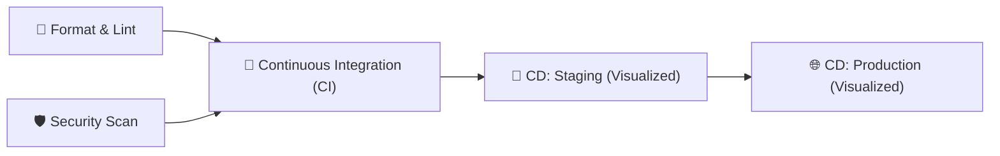

# AuraTask ✨

A modern, fluid, and beautifully animated to-do list web application crafted with vanilla HTML5, CSS3, and JavaScript. Designed with glassmorphic aesthetics, ambient glowing patterns, soundscapes, micro-interactions, and a GitHub Actions CI/CD workflow pipeline.

---

## 🎨 Visual Patterns & Design System

- **Ambient Mesh & Geometric Backdrop**: Multi-layered glowing radial gradient orbs with dynamic floating animations and a subtle geometric dot-matrix overlay.
- **Glassmorphism**: Translucent frosted panels (`backdrop-filter: blur(20px)`), perimeter neon borders, and inset light reflections.
- **Micro-Interactions**:
  - Custom SVG animated checkbox with checkmark draw transition (`stroke-dashoffset`).
  - Staggered spring entrance animations for new tasks.
  - Smooth slide-and-collapse task removal animation.
  - Interactive circular SVG progress ring and linear progress bar dynamically reacting to task completion.
  - **Canvas Confetti Particle Explosion**: Lightweight physics-based confetti bursts when completing tasks.
  - **Web Audio API Soundscapes**: Synthesized harmonic audio chimes on completion and interactions (zero external audio files needed; includes a quick mute toggle).
- **Theme Modes**: Seamless Dark Obsidian & Light Alabaster themes with smooth 360° rotation transitions.

---

## ✨ Features

- **Task Management**: Create, edit, star/pin to top, toggle completion, and delete tasks.
- **Metadata Support**:
  - Priority flags: 🟢 Low, 🟡 Medium, 🔴 High with neon accents.
  - Categories: 💼 Work, 👤 Personal, 🎨 Design, 💻 Code, 🌿 Health.
  - Due Dates: Color-coded status indicators for *Today*, *Overdue*, and *Upcoming*.
- **Productivity Dashboard**: Live statistics counter (Total, Active, Completed, Productivity percentage ring).
- **Search & Filtering**:
  - Instant real-time fuzzy search with keyboard shortcut (`/`).
  - Filter tabs: *All*, *Active*, *Completed*.
  - Priority filter dropdown.
  - Sorting: *Newest*, *Oldest*, *Priority*, *Due Date*, *Alphabetical*.
- **Persistence**: Automatic client-side synchronization using `localStorage`.
- **Keyboard Shortcuts**:
  - `Enter`: Quickly submit new task.
  - `/`: Focus search input.
  - `Esc`: Close modals.

---

## 🚀 Getting Started

### Direct Run
Because AuraTask is built with pure web standards (HTML5, CSS3, JavaScript ES2021), you can run it immediately without any build step:

Double-click `index.html` or open it directly in any modern browser (Chrome, Edge, Firefox, Safari).

### Local Development Server
To serve via a lightweight HTTP server:

```bash
# Using Python
python -m http.server 8080

# Using Node.js (npx)
npx serve .
```

Open `http://localhost:8080` in your browser.

---

## 🛡️ GitHub Actions CI/CD Pipeline

The repository includes a comprehensive GitHub Actions workflow located in [`.github/workflows/ci-cd.yml`](.github/workflows/ci-cd.yml).

### Pipeline Stages



1. **Format & Code Quality Pipeline (`format-and-lint`)**:
   - Executes Prettier check across HTML, CSS, JavaScript, JSON, and Markdown files.
   - Runs ESLint rules check.
2. **Security Testing Pipeline (`security-scan`)**:
   - Dependency vulnerability audit (`npm audit --audit-level=high`).
   - Static Application Security Testing (SAST) scanning for unsafe execution sinks (`eval`) and unescaped inputs.
   - Secret pattern scanning.
3. **Continuous Integration (CI) (`continuous-integration`)**:
   - Validates asset file structure and integrity (`index.html`, `styles.css`, `app.js`).
   - Executes smoke tests.
   - Packages and uploads production build distribution artifact.
4. **Continuous Delivery (CD) - Staging (`cd-deploy-staging`)**:
   - Visualized and simulated deployment pipeline with preview environment configuration and verification.
   - Real cloud deployment actions (Cloudflare Pages / AWS / Vercel) provided in clear, commented format as requested.
5. **Continuous Delivery (CD) - Production (`cd-deploy-production`)**:
   - Visualized deployment pipeline with CDN cache invalidation simulation and release summary.
   - Production deployment commands provided in comments.

---

## 🛠️ Project Structure

```
startup/
├── .github/
│   └── workflows/
│       └── ci-cd.yml         # GitHub Actions CI/CD Pipeline
├── .eslintrc.json            # ESLint code style rules
├── .gitignore                # Git ignored patterns
├── .prettierrc               # Prettier formatting configuration
├── app.js                    # Core application logic & Web Audio synthesizer
├── index.html                # Modern semantic HTML5 markup
├── LICENSE                   # Project license
├── package.json              # NPM scripts for linting, format, & CI
├── README.md                 # Project documentation
└── styles.css                # CSS variables, animations, glassmorphism
```

---

## 📄 License

This project is licensed under the MIT License.
